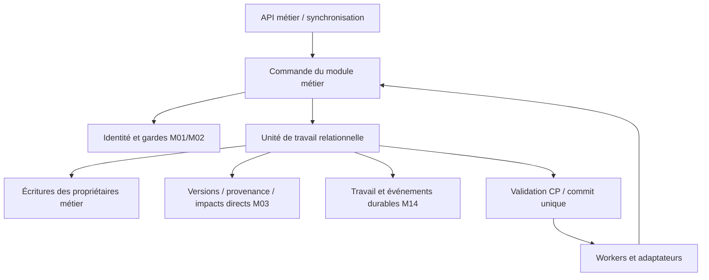

# GENIIUS — Modules du Core, responsabilités et transactions V0.1

**13 octobre 2026 — architecture candidate, non gelée.** Dossier 1 du [cadrage](GENIIUS_ARCHITECTURE_01_CADRAGE.md). Références : [CDC V1.2 gelé](../06_CDC_TECHNIQUE/GENIIUS_CDC_TECHNIQUE.md), [MLD V1.1-g](../05_MLD/GENIIUS_MLD.md), [catalogue autorisations](../05_MLD/GENIIUS_MLD_AUTORISATIONS.md), [contrat V1.6](../04_CONTRAT_AUTORISATION/GENIIUS_CONTRAT_AUTORISATION.md), CDCF V1.3 et dictionnaire V1.3. Ce document définit le découpage et les contrats logiques ; le mécanisme physique de concurrence et les technologies restent à démontrer au MPD et dans les ADR suivants.

## 1. Décision d’architecture ADR-CORE-001

Le Core reste un monolithe modulaire, avec une base relationnelle canonique initialement unifiée. Les modules ci-dessous possèdent des écritures et des règles métier ; ils ne sont ni des applications clientes ni des services distribués indépendants. Tree, Journal, Echo, Rebond, Connect et Atlas composent leurs parcours à travers ces contrats.

**Alternative évaluée :** un module par table rendrait les invariants transversaux difficiles à porter ; un module par application dupliquerait les entités, les droits et la provenance. Le découpage proposé sépare les responsabilités stables et garde des transactions communes lorsque l’invariant l’exige. L’extraction future d’un module demandera un nouvel ADR et une preuve de conservation des invariants, sans remplacer une atomicité critique par de la simple cohérence éventuelle.

La [matrice exhaustive](GENIIUS_ARCHITECTURE_03_CORE_MATRICES.md) attribue chaque table logique actuelle à un seul module d’écriture, toutes les CP-01 à CP-53 et les soixante obligations détaillées CP-13/DI à leurs responsabilités. Cette attribution est une proposition architecturale, pas une modification du MLD. Une FK entre modules reste une contrainte réelle ; elle n’autorise pas à écrire dans les tables d’un autre module.

## 2. Modules et contrats publics internes

| Module | Responsabilité et données possédées | Commandes / consultations internes |
|---|---|---|
| M01 — Identité | Comptes, acteurs opérateurs, correspondances compte/personne, pseudonymes, préférences de sollicitation/blocages ; identité d’autorisation | ÉtablirIdentité, LierCompte, RévoquerSession ; RésoudreActeurPersonne. Une personne historique de recherche appartient à M06. |
| M02 — Accès et espaces | Espaces, groupes/appartenances, autorisations, propriété/racine, titularité, protections, dérogations ; licences/classifications/masquages, consentements et volontés | CréerEspace, Nommer, Habiliter, Révoquer, Protéger, Transférer, StatuerConsentement ; ÉvaluerAccès, ConstruireGrapheAccessible. Les projections n’accordent aucun droit. |
| M03 — Socle scientifique | Identifiants d’objets/liens, versions et activités communes, provenance/filiation, références, bases justificatives et dépendances communes | CréerIdentitéObjet, EnregistrerVersion, Relier, PoserImpactDirect, RésoudreRéférence ; primitives appelées avec les règles des modules de spécialisation. |
| M04 — Référentiels | Concepts, signatures, libellés et versions de référentiels | ProposerConcept, PromouvoirConcept, ValiderSignature ; LireDéfinitionVersionnée. Promotion scientifique humaine distincte d’une migration technique. |
| M05 — Sources et lecture | Documents, exemplaires, unités/pages/zones/fichiers, reproductions/citations ; transcriptions, mentions, annotations ; reconstructions documentaires | DéposerSource, ConfirmerConservation, EnregistrerLecture, ReconstruireDocument ; RésoudreZone et disponibilité réelle. Rebond utilise ces contrats. |
| M06 — Connaissance et validation | Entités historiques, identifications, assertions, valeurs/interprétations, évaluations, débats et crédits | ProposerIdentification, RéviserAssertion, Évaluer, Contester ; LireÉtatScientifique. Aucun algorithme ou rôle administratif ne valide implicitement. |
| M07 — Recherche et pilotage | Projets/questions/protocoles/missions/tâches, rattachements, axes/ressources ; corpus/calculs/résultats reproductibles ; organisation personnelle et veille | CréerProjet, Rattacher, AffecterMission, CloreLot, CalculerIndicateur ; ÉtatRecherche et périmètre de résultat. Echo compose ces contrats. |
| M08 — Tree et circulation | Arbres/nœuds/liens de reconstitution, choix contextuels, sélections, manifestes et flux contributifs | ProposerSélection, AccepterManifeste, Contribuer, Réutiliser ; ComparerBranches. Pas de partage transitif ni modification scientifique de l’arbre destinataire sans acte autorisé. |
| M09 — Mémoire et participation | Sessions/témoignages/capsules/campagnes Journal, événements et contributions Connect | EnregistrerTémoignage, RépondreCampagne, ClorePhase, ProposerContribution ; consultation filtrée. Consentements et droits restent M02. |
| M10 — Cartographie | Cartes, représentations géométriques et couches historiques | EnregistrerCarte, ProduireVueCartographique ; incertitude, temporalité, fondements et propagation conservés. Atlas n’établit aucune causalité. |
| M11 — Publication et échanges | Publications, approbations éditoriales, séries/acceptations, diffusions, exports/imports/restaurations patrimoniales | PréparerPublication, AccepterParution, Diffuser, PréparerExport, RéconcilierImport. Décision éditoriale, validation scientifique et diffusion sont trois actes distincts. |
| M12 — Financement | Financements, abonnements, prises en charge et imputations | AccepterAccord, ImputerConsommation ; LireConsommation. Date effective, ordre déterministe, plafonds et idempotence ; aucun droit de contenu. |
| M13 — Synchronisation | Réception privée différée puis contributions à références résolues ; négociation applicative et état technique de réconciliation | RecevoirDelta, RésoudreDelta, IntégrerDelta ; LireAccuséPrivé. Ne possède aucune seconde version canonique des connaissances. |
| M14 — Exécution durable | Registre technique de commandes/idempotence, événements à délivrer, tâches/tentatives et effets externes ; obligations ST pertinentes | ProgrammerTravail, PrendreTâche, EnregistrerTentative, Rejouer ; aucune écriture scientifique directe par un worker. Tables physiques techniques à définir au MPD. |

Les historiques de spécialisation appartiennent au même module que leur courant ; M03 fournit la mécanique de versionnement, sans s’approprier leurs règles. Un lien métier spécialisé appartient à son module ; sa ligne commune `lien` est produite par M03 dans la même transaction. Un conteneur requiert le manifeste/version_composant aux jalons prescrits par le MLD.

**Adaptateurs distincts :** index/caches/recherche, stockage binaire, IA/OCR et authentification externe exécutent les contrats sans devenir autorités métier. Les lecteurs passent par des vues/services filtrés ; les modules n’effectuent aucune requête révélatrice hors du graphe autorisé. Les API exposent des capacités métier, pas les tables ni les primitives privées de M03/M14.

## 3. Unité de travail et dépendances permises

Une commande métier est coordonnée par le module qui porte son intention (par exemple M08 pour une réutilisation). Elle ouvre **une unité de travail relationnelle** et appelle les commandes internes des autres propriétaires ; toutes les écritures critiques partagent le même commit. Chaque propriétaire écrit seulement ses tables. M03 fournit versions/provenance et M02 les gardes d’autorisation ; ces appels ne créent pas de transactions imbriquées autonomes.

Les dépendances obligatoires sont : métier → M01 pour l’acteur, M02 pour les droits/consentements, M03 pour versions/liens, M04 pour concepts, M14 pour travail durable. Les appels spécialisés intermodules sont orchestrés par la commande principale via interfaces explicites, sans appels récursifs entre modules ni accès à leurs dépôts privés. Les modules génériques n’appellent pas les modules applicatifs : ils reçoivent les validations requises et événements enregistrés par l’orchestrateur. La vérification globale avant commit peut réunir plusieurs validateurs CP.

## 4. Contrat commun d’une commande

L’enveloppe interne porte identité de commande, acteur/personne résolus côté serveur, action/finalité, contexte d’espace, objets et versions attendues, versions client/schéma/référentiel, corrélation, empreinte de l’entrée et horodatage serveur. Les valeurs fournies par le client ne font pas autorité sur les rôles, l’époque, l’identité établie ou le temps effectif.

1. Authentifier, déterminer l’intention et les règles applicables ; réserver une identité de commande dans le contexte du demandeur, sans créer de droit.
2. Valider les références fournies par accès `voir` **avant** contraintes FK/UQ observables (CP-49/50), puis vérifier l’action et ses fondements courants. La réception opaque T08 est la procédure spéciale prévue par CP-27, sans résolution initiale de cible.
3. Ordonnancer les gardes de sécurité et les écritures concurrentes : objet/version attendue, espaces et fondements/protections/ascendants concernés, ensemble/lot/financement si applicable. Une écriture ne peut pas valider ses droits sur un état antérieur à une révocation déjà effective.
4. Écrire activité, nouvelle version, historiques, associations, manifeste/empreinte et impact direct ; appliquer les contraintes de fin de transaction. Une simple sauvegarde de brouillon n’est pas un enregistrement scientifique.
5. Enregistrer résultat de commande et travail durable dans la même transaction ; commit. Retourner seulement la représentation filtrée par les droits actuels, et non un cliché brut interne.

Le mécanisme doit **sérialiser la décision d’accès, l’écriture et toute révocation concurrente pertinente** : garde commune jusqu’au commit ou mécanisme équivalent démontré. Un simple contrôle d’époque suivi d’un commit sans coordination ne suffit pas. L’ordre des gardes est déterministe pour réduire les interblocages ; panne/conflit temporaire entraîne reprise bornée avec réévaluation complète. Le choix physique reste MPD-02/06. Une transaction longue ne retient pas ces gardes pendant un transfert binaire ou un appel IA.

Rejeu : identité de commande + demandeur + empreinte d’entrée donnent un seul effet logique. Même identité avec entrée différente donne un conflit non révélateur. Un rejeu ne restitue jamais un résultat confidentiel enregistré avant révocation : la réponse est reconstruite/filtrée sous droits actuels, ou limitée à un accusé autorisé. Une reprise n’accorde pas automatiquement l’autorisation de poursuivre une tâche.

## 5. Catalogue des transactions

| ID / coordinateur | Écritures atomiques et invariants | Ce qui vient après commit |
|---|---|---|
| T01 — Création d’espace, M02 | Espace + propriété administrative + racine système concordantes + activité/états d’autorisation/époque ; aucun espace non clos orphelin | Notification minimale autorisée. |
| T02 — Création/mutation scientifique, module métier | Objet et spécialisation + titularité si requise + activité/version/historiques/associations/manifeste + dépendances directes/impact + travail transitif ; signature, droits et attributs figés contrôlés | Recalculs techniques, indexation ; aucune validation scientifique implicite. |
| T03 — Droit/protection/consentement, M02 | Acte/versions/admissions/protections + fermeture des fondements dépendants quand prescrite + époque à prise d’effet + barrières de résultats affectés + événements ; consentement : restriction prudente pendant réexamen | Propagation/reconstruction de projections ; signalement P-3 opaque à la seule autorité. |
| T04 — Rattachement/lot/mission, M07 | Accord bilatéral/phase/version + actes d’habilitation explicitement admissibles via M02 ; clôture ferme fondements conditionnés ; réouverture ne les ressuscite pas | Avis sous droits ; recalcul d’avancement sur objets accessibles. |
| T05 — Sélection/copie/contribution, M08 | Version active/manifeste, accord/régime/flux + objets destinataires et filiation + titularité et protections héritées applicables + activités/dependances ; aucune copie exposée avant héritage | Propagation de protections ultérieures sous barrière avant exposition, indexation filtrée. |
| T06 — Transfert/succession, M02 | Présentation/engagements figés, voies par objet et réémissions ; acceptation atomique change propriété/racine, fondements et protections selon § 10, verrou de retour par personne/acte, époque et journal | Avis filtrés ; expiration et autorités légales restent opposables. |
| T07 — Diffusion/publication, M11 | Acte éditorial distinct, snapshot/version publiée, acceptation interespaces avant placement/rang ; diffusion enregistrée seulement après validation scientifique/diffusabilité et droits actuels requis | Téléchargement/envoi vérifie de nouveau le droit au dernier point d’exposition ; diffusion enregistrée ≠ preuve d’envoi effectif. |
| T08 — Réception différée, M13 | Delta seul dans espace personnel de l’auteur, références client opaques sans FK de cible ; identité de réception/accusé idempotent, sans preuve d’existence de cible | Résolution contrôlée T09 ; refus ne publie pas le delta. |
| T09 — Intégration différée, M13 puis module métier | Correspondance réception → contribution résolue, versions attendues et droits au temps serveur, mutation T02 et état intégré dans le même commit ; conflit/refus garde le delta privé | Accusé filtré, réconciliation explicite ; intégré ≠ validé scientifiquement. |
| T10 — Dépôt binaire, M05 | Petites transactions pour réception technique puis confirmation : métadonnées et disponibilité confirmée seulement après preuve de conservation du binaire ; aucune atomicité fictive base/stockage | Nettoyage/reprise des dépôts en attente, dérivés ; pas suppression aveugle d’un fichier orphelin. |
| T11 — Évaluation/révision, M06 | Acte humain, base/justification, version de résultat et statuts dérivés, provenance et CP ; dépendances corrigées et impacts T02 | Réexamen transitive ; historique des positions maintenu. |
| T12 — Calcul/carte/IA, M07/M10/M05 selon résultat | Entrées admissibles et versions/référentiels enregistrés, consentement avant transmission ; résultat/provenance/type/examen dans T02 ; pas résultat définitif si base devenue obsolète | Calcul externe hors transaction ; revalider droits, base et purge avant intégration et diffusion. |
| T13 — Imputation, M12 | Consommation unique, accords admissibles à date effective, ventilation déterministe et plafonds protégés contre concurrence ; lien à identité de consommation, aucune double facture/imputation | Export de facturation sous droits ; ajustement explicite selon modèle, pas annulation silencieuse d’une consommation réelle. |
| T14 — Purge, M03 avec M02 et propriétaires | Dossier autorisé et barrière d’exposition, neutralisation courants/historiques/associations/résolution selon CP-16 ; empreintes/états permis, conservation des seules traces légitimes ; journal de non-résurrection durable | Suppression binaire/index/cache/répliques sous suivi ; purge complète non déclarée tant que obligations résiduelles ne sont pas satisfaites. |
| T15 — Migration de référentiel, M04/M03 | Validation scientifique requise pour sémantique, versions et correspondances, checkpoints par lots cohérents ; aucun état partiellement migré rendu comme cohérent | Clients incompatibles en attente ; conservation des contributions locales ; activation après contrôles. |
| T16 — Restauration, exploitation via propriétaires | Service fermé, restauration cohérente base/médias, réconciliation droits/purges actuels par transactions ; barrière d’ouverture jusqu’à preuve complète | Reprise contrôlée tâches/index ; RPO/RTO évalués sur service cohérent, pas seulement base démarrée. |
| T17 — Identité et compte, M01 | Établissement/retrait de preuve d’identité, liens compte/personne, statut du compte et actes associés ; M02 applique dans le même commit les changements de fondements/approbations et époque que le contrat impose. Toute correspondance est établie par procédure vérifiée, jamais par simple déclaration de l’appelant | Sessions/projections revérifiées ; deux comptes d’une personne ne deviennent pas deux approbateurs indépendants. |

Le transfert T06 peut toucher plusieurs modules : les commandes de leurs propriétaires rejoignent la même unité de travail. Les noms et états exacts restent ceux du contrat V1.6, sans transition intermédiaire visible inventée. Les opérations de purge/migration massives ont des lots de reprise, mais une barrière empêche d’exposer une incohérence entre lots. T17 sérialise les changements d’identité pertinents avec les actes qui en dépendent ; ses effets suivent exactement les règles de fondement du contrat, sans inventer de révocation générale.

## 6. Événements, workers et effets externes

Une mutation qui réclame un traitement différé écrit **dans son commit** un enregistrement durable de travail à délivrer (outbox logique, hébergement physique à choisir). Son enveloppe contient identité d’événement, type/version de contrat, commande/corrélation, version des agrégats, contexte/époque, acteur et finalité, clés d’idempotence et références minimales internes. Aucun contenu scientifique n’est envoyé à un destinataire par ce seul enregistrement. Le payload et le journal sont eux-mêmes protégés et neutralisables lors de purge.

La livraison peut être répétée : accusé de consommation et effets relationnels du consommateur sont atomiques ; déduplication par identité/version, ordre par agrégat lorsque nécessaire, événements anciens incapables de réactiver un droit ou d’effacer un impact nouveau. L’enregistrement durable appartient à M14 ; le worker appelle la commande du propriétaire métier. Les tentatives/pannes sont observables et n’accordent aucun privilège scientifique au compte technique.

**Événements minimaux :** VersionScientifiqueEnregistrée (T02 → propagation/index), FondementModifié (T03 → projections), ProtectionOpposableModifiée (T03/T05 → copies), RéceptionDifféréeEnregistrée (T08 → résolution), FichierConservationConfirmée (T10 → dérivés), PublicationPréparée (T07 → artefact), ConsommationConstatée (T13 → suivi), PurgeOpposable (T14 → caches/médias/répliques). La révocation et le marquage direct sont déjà opposables au commit ; leur événement ne conditionne pas leur effet.

Pour le stockage objet : l’empreinte, l’identité de dépôt et un état contrôlé permettent reprise ; une disponibilité manquante n’est jamais une disponibilité confirmée. Pour l’IA : consentement/droits sont contrôlés avant envoi, le résultat est une proposition, son intégration réévalue les droits ; aucune donnée R/I n’est envoyée à un prestataire. Pour les notifications/exports : revalider avant sortie, à chaque page/reprise ; une URL permanente utilisable sans contrôle courant est incompatible avec une révocation effective. Les fragments d’un flux déjà délivrés et les copies sorties de GENIIUS ne sont pas rappelables ; les envois suivants sont interrompus ou refusés.

## 7. Contrats d’erreur et de lecture

Absence et cible inaccessible : introuvable, sans révélation par validation FK/UQ, titre, compte, métadonnée ni journal consultable par l’appelant. Erreurs de version, conflit scientifique ou transition ne sont détaillées qu’après accès aux cibles concernées. Défaillance d’autorité : refus ; avis global d’incident possible sans confirmer de cible. Un échec avant commit laisse zéro mutation métier ; après commit, un échec externe garde l’état enregistré et la tâche reprenable, sans prétendre que l’effet externe est terminé.

Une lecture établit son graphe et son état d’autorité avant calcul révélateur. Projections et caches portent le contexte, les versions/époque et la plus proche échéance ; leur absence de fraîcheur ferme l’accès. Une histoire ou un résultat figé est consulté sous droits actuels ; l’état scientifique historique n’est pas un ancien droit d’accès. Le journal/audit ne constitue jamais une interface alternative pour résoudre une cible protégée.

## 8. Scénarios de crash-test et preuves aval

| Scénario | Verdict requis |
|---|---|
| C01 — Créer espace, panne avant racine | Aucun espace non clos partiellement initialisé. |
| C02 — Révoquer pendant une écriture/export | Ordre accès/révocation démontré ; aucune écriture après droits expirés ni sortie ultérieure non autorisée. |
| C03 — Modifier preuve, perdre worker transitif | Direct marqué au commit ; aucun aval prétendu à jour ; reprise ne perd pas impact. |
| C04 — Rejouer commande après révocation | Un effet logique, aucune restitution de contenu par ancien accusé. |
| C05 — Copie puis protection/purge d’ascendant | Copie ne blanchit pas protection ; non-levables héritées encore opposables. |
| C06 — Hors ligne, échéance puis connexion | Réplique protégée inaccessible à échéance ; delta privé intact ; intégration sans droits refusée. |
| C07 — Binaire conservé puis commit absent, et inverse | État explicite/reprise, aucune fausse disponibilité ni suppression aveugle. |
| C08 — Imputations concurrentes et accord expiré au traitement | Date effective correcte, plafond jamais dépassé, pas de double imputation. |
| C09 — Transfert concurrent à retour du cédant | Racine/propriété concordantes ; consentement par acte/personne, pas de retour par second compte. |
| C10 — Purge puis restauration/sync ancien client | Aucun contenu ni droit clos ressuscité, ouverture sous barrière. |
| C11 — Cycle de dépendance/justification | Production acyclique ; raisonnement cyclique détecté, pas preuve indépendante fabriquée. |
| C12 — Série/publication et révocation avant envoi | Acceptation/rang filtrés ; validation éditoriale ne donne pas droit de diffusion. |
| C13 — Deux comptes, même personne ; identité modifiée pendant approbation | Indépendance par personne, état d’identité actuel et contraintes d’approbation vérifiés dans l’ordre transactionnel, sans auto-approbation. |

Ces scénarios sont spécifiés, non exécutés. La vérification documentaire prouve l’inventaire des responsabilités, les liens et la couverture des CP ; elle ne prouve pas la sérialisation, l’égalité des délais, les performances ni le comportement d’un stockage réel. ADR suivants : mécanisme de gardes/époque et politique de diffusion, protocole de synchro/horloge locale, stockage et reprise, files et propagation/MPD-04. Ils doivent fournir mécanisme concret, alternatives, traces de concurrence/panne et verdicts de ces scénarios avant validation de l’architecture.
