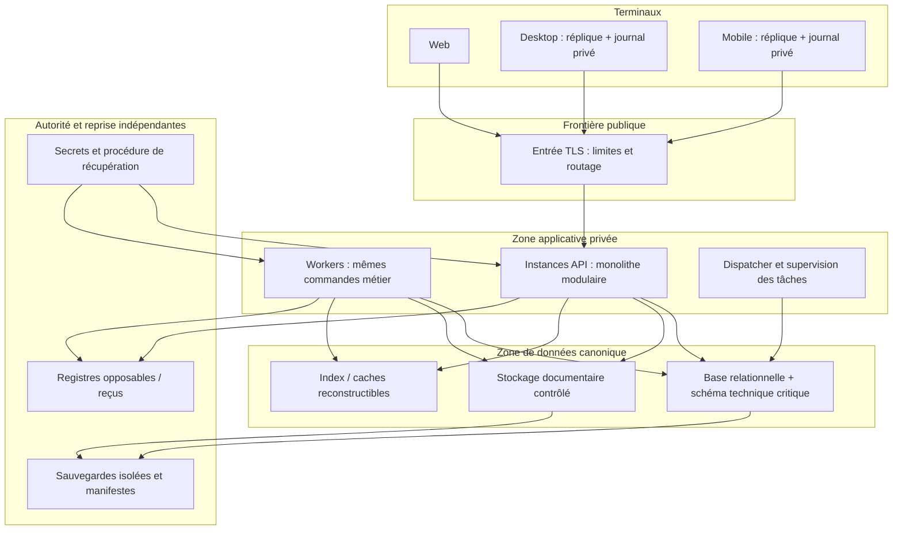

# GENIIUS — Vues de déploiement et frontières V0.1

**13 octobre 2026 — candidat, non gelé.** Entrées : [modules](GENIIUS_CORE_MODULES_TRANSACTIONS_V0_1.md), [sécurité](GENIIUS_AUTORISATIONS_ISOLATION_CONCURRENCE_V0_1.md), [synchronisation](GENIIUS_SYNCHRONISATION_COMPATIBILITE_HORLOGE_V0_1.md), [persistance](GENIIUS_PERSISTANCE_CONSERVATION_RESTAURATION_V0_1.md), [asynchronisme](GENIIUS_ASYNCHRONE_PROPAGATION_DIMENSIONNEMENT_V0_1.md). Le porteur a précisé le 13/10/2026 un plafond de 100 € par mois avant abonnements, avec premiers abonnements souhaités en décembre 2026. Il demande de terminer les six prototypes avant le lancement commercial. Aucune contrainte de langage/hébergeur n’est imposée ; capacité et exploitation doivent respecter ce plafond, sans engagement de date de livraison non démontré.

## 1. ADR-CORE-015 — Topologie de référence à éprouver

La topologie sépare instances API, workers, base canonique, stockage objet et fonctions critiques de reprise. Les quatorze modules restent des modules du monolithe ; le dessin ne crée pas quatorze services. Les mêmes contrats métier sont utilisés par API et workers. Le nombre d’instances et les dimensions des ressources seront déterminés par mesure ; un dessin redondant n’atteste pas un SLO ni un PRA.

Les registres de reprise ont leur propre protection et ne régressent pas avec la base restaurée. La zone Reprise décrit une **exigence de séparation des domaines de panne et de contrôle**, pas une preuve que deux comptes, régions ou conteneurs suffisent. Les écritures de registres suivent PER-03 ; pas de transaction atomique implicite entre services. L’accès aux secrets ne confère pas, par lui-même, un droit de consultation scientifique.

## 2. Identités et flux autorisés

| Frontière | Flux permis | Contrôle / interdiction |
|---|---|---|
| Terminal → entrée/API | API métier et synchronisation authentifiées, réception opaque admissible, données filtrées | Pas SQL direct, stockage canonique ou clé serveur sur terminal ; quotas techniques sans suppression de delta. |
| API → base | Commandes des propriétaires, transactions et garde canonique | Compte applicatif non propriétaire technique des tables lorsque défense données le requiert ; contexte de sécurité contrôlé côté serveur. |
| Worker → métier/base | Tentative avec bail, contexte/finalité et primitive d’invariant étroite | Pas remplacement des droits perdus de l’acteur par un compte scientifique global. |
| API/worker → fichiers | Dépôt isolé, conservation, dérivation et délivrance contrôlée | Pas contournement des droits courants par URL durable ; URL/portions à démontrer sous SEC-03. |
| Application → index/cache | Représentations candidates, graphe autorisé et génération | Aucune source de permission autonome, aucune réplique de base retardée pour décider un accès. |
| Application → prestataire IA/OCR | Données admissibles et consentement, exécution tracée | Pas attributs R/I transmis ; résultat proposition, revalidation avant intégration/sortie. |
| Exploitation → administration | Supervision minimisée, maintenance contrôlée, réauthentification | Pas lecture implicite du patrimoine privé ; dérogation nominative bornée si le contrat l’exige. |
| Reprise → restauration | Manifestes, clés admissibles, registres opposables, contrôles R01–R07 | Ouverture refusée si autorité/purges/intégrité non démontrées. |

Les chemins d’administration, de sauvegarde et de diagnostic ne deviennent pas des chemins de recherche scientifique. Les logs, métriques, traces et manifests sont soumis à leurs propres permissions/minimisation. TLS, permissions réseau et chiffrement au repos sont des défenses complémentaires, pas le moteur d’autorisation.

## 3. Deux variantes d’exploitation à comparer

| Variante | Services et exploitation | Charge de responsabilité et preuve |
|---|---|---|
| D01 — Services de données gérés | API/workers déployés séparément ; base et stockage gérés ; registres/sauvegardes dans domaine indépendant vérifié | Examiner régions, droits d’administration, restauration, exportabilité, clés, limites/quotas et contrat de rétention. Un service géré ne prouve ni conformité V1.6 ni RPO/RTO GENIIUS. |
| D02 — Services exploités par l’équipe | Même topologie logique ; base, stockage et dispatcher/file opérés par l’équipe ou partenaire dédié | Documenter maintenance, mises à jour, surveillance, astreinte, réplication/sauvegarde, capacité et reprise. Coût infrastructure seul ne représente pas coût total. |

Une VM ou un conteneur unique peut servir de banc local ; il n’est pas la preuve d’indépendance des copies ni de la qualité de service cible. Une redondance de processus ne protège pas d’un compte compromis, d’une corruption logique ou d’une région perdue. Le choix D01/D02 demande compétences, charges mesurées et coût complet ; aucune variante n’est ratifiée comme production.

## 4. DEV, STAGING, PROD et livraison

Environnements séparés avec identités/secrets/permissions distincts ; corpus synthétique ou exceptionnellement autorisé, jamais copie ordinaire de patrimoine réel. STAGING représente les mécanismes critiques ; les grandes campagnes peuvent utiliser une capacité temporaire, versionnée dans le manifeste de mesure. Les sauvegardes de PROD ne sont pas des jeux de développement accessibles librement.

Livraison : artefact identifié → contrôles automatiques proportionnés → migration compatible → activation contrôlée → sondes/validation → bilan. Le client hors ligne impose une fenêtre explicite de compatibilité et des conversions sans perte. Un rollback restaure une version logicielle compatible, pas une ancienne autorité permissive ni un contenu purgé. Une migration partielle garde le périmètre fermé ; son coût et sa durée entrent dans l’étude.

## 5. Disponibilité, restauration et capacité

Le SLO essentiel demeure 99,9 % mensuel après stabilisation, mesuré sur opérations utiles. Base, garde d’autorité et stockage canonique sont des dépendances critiques ; cache/index/OCR peuvent avoir une dégradation encadrée. Un SLO ne permet pas d’ignorer une révocation ou un impact scientifique. Dossiers SEC/PER/ASY fixent les comportements en panne.

La variante testée doit démontrer : répartition de charge entre API/workers sans famine de révocation ; reprise après perte de processus et de domaine de panne ; restauration avec autorité/purges actuelles ; échecs de prestataire ; anciennes sessions/curseurs après reprise. Les ressources ne sont pas chiffrées arbitrairement. Les configurations, quotas et unités de coût sont arrêtés à partir du profil programme et des profils patrimoniaux validés.

## 6. Dossiers de preuve pour choisir le déploiement

| ID | Preuve requise | Renvois |
|---|---|---|
| DEP-01 | Carte des domaines de panne/contrôle, identité réseau et secrets, fournisseurs et régions | DEC-ARCH-01/16, PER-01/03/05. |
| DEP-02 | Contrat d’exploitation et astreinte, incidents, délais de correction, maintenabilité | PAR-CDC-08/09/10, TECH-021/027/030. |
| DEP-03 | Livraison/migrations, compatibilité/rollback et ancien client | SYN-02/07, T15/T16, TECH-022/023/031. |
| DEP-04 | Capacité, coût nominal/pointe/reprise, quotas et sortie du fournisseur | ASY-03/04/06, PER-02/07, TECH-026/029. |

Ces quatre dossiers de preuve sont ouverts. Les volumes et le nombre d’instances sont des résultats attendus de l’étude, pas des paramètres déjà approuvés. Les variantes ne sont pas déployées et aucun test d’infrastructure n’est revendiqué ici.
